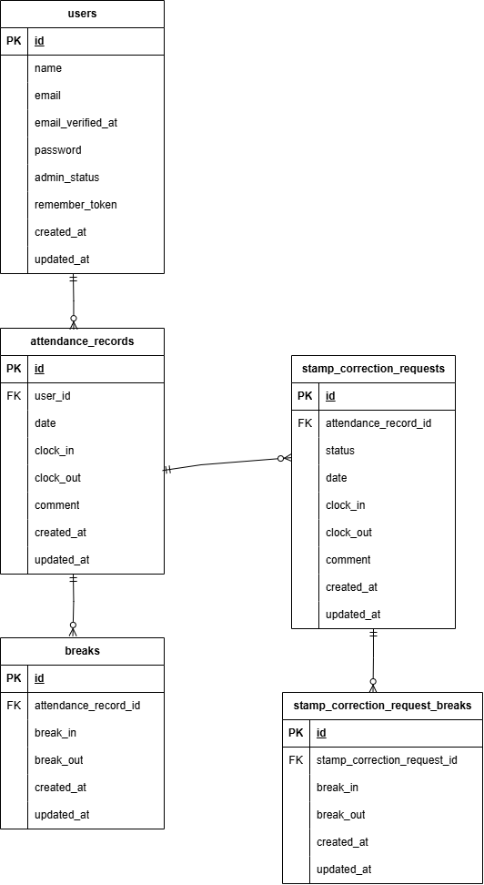

# 勤怠管理アプリ

## アプリケーション概要

Laravel 10を使用して開発した勤怠管理アプリケーションです。

一般ユーザーの出退勤・休憩の記録、勤怠一覧・詳細の確認、勤怠修正申請、管理者による勤怠管理・申請承認に対応しています。

また、月別の勤怠レポート表示と、勤怠情報を扱うAPI機能を実装しています。

## 使用技術

- PHP 8系（Composer要件：8.1以上、9.0未満）
- Laravel 10
- Laravel Fortify
- Laravel Sanctum
- MySQL 8.4
- Docker / Laravel Sail
- phpMyAdmin
- Mailpit
- Vite 5
- PHPUnit 10

## 環境構築

### 1. リポジトリの取得

```bash
git clone git@github.com:kurahasy703/attendance-app.git
cd attendance-app
```

※ SSH接続を設定していない場合は、HTTPSでクローンしてください。

### 2. PHPライブラリのインストール

Docker Desktopを起動した状態で、Composerを使用して必要なPHPライブラリをインストールします。

**Composerがインストールされている場合**

```bash
composer install
```

**Composerがインストールされていない場合**

Dockerの公式Composerイメージを使用してインストールできます。

```bash
docker run --rm \
  -u "$(id -u):$(id -g)" \
  -v "$(pwd):/app" \
  -w /app \
  composer:2 install --ignore-platform-reqs
```

※ 上記のDockerコマンドは、WSL2などのLinux環境のターミナルで、Laravelプロジェクトのルートディレクトリから実行することを想定しています。

※ `--ignore-platform-reqs` は、Composer実行環境とLaravel Sail内のPHP環境の違いによる依存関係チェックを一時的に省略するオプションです。実際のアプリケーションはLaravel Sail内で動作させます。

### 3. 環境変数の設定

```bash
cp .env.example .env
```

`.env` のデータベース設定を確認してください。

```dotenv
DB_CONNECTION=mysql
DB_HOST=mysql
DB_PORT=3306
DB_DATABASE=laravel
DB_USERNAME=sail
DB_PASSWORD=password
```

※ `password` はローカル開発用の設定例です。

### 4. Dockerコンテナの起動

```bash
./vendor/bin/sail up -d
```

### 5. アプリケーションキーの生成

```bash
./vendor/bin/sail artisan key:generate
```

### 6. データベースの作成

```bash
./vendor/bin/sail artisan migrate
```

### 7. テストデータの登録

```bash
./vendor/bin/sail artisan db:seed
```

### サンプルデータ

Seederを実行すると、一般ユーザー2名と管理者1名、および勤怠・休憩のサンプルデータが登録されます。

**Seederで登録される勤怠データ**

| ユーザー          |  勤怠件数 |
| ----------------- | --------: |
| user1@example.com |      92件 |
| user2@example.com |      90件 |
| user3@example.com |      90件 |
| **合計**          | **272件** |

**開発環境で追加した動作確認用データ**

2026年11月に、勤怠登録・修正申請・管理者による修正などの動作確認を目的として、勤怠データを5件追加しています。

| データ区分                 |  勤怠件数 |
| -------------------------- | --------: |
| Seederによるサンプルデータ |     272件 |
| 追加した動作確認用データ   |       5件 |
| **開発環境の合計**         | **277件** |

※ 追加した5件はSeederには含まれないため、新規環境でSeederを実行した場合は272件が登録されます。

### 8. フロントエンドのビルド

```bash
./vendor/bin/sail npm install
./vendor/bin/sail npm run build
```

### 9. アプリケーションへのアクセス

- 一般ユーザーログイン：`http://localhost/login`
- 管理者ログイン：`http://localhost/admin/login`
- phpMyAdmin：`http://localhost:8080`
- Mailpit：`http://localhost:8025`

※ ポートを変更している場合は、変更後の番号を使用してください。

## テストアカウント

| ユーザー名     | 権限         | メールアドレス    | パスワード |
| -------------- | ------------ | ----------------- | ---------- |
| テスト太郎     | 一般ユーザー | user1@example.com | password   |
| テスト花子     | 一般ユーザー | user2@example.com | password   |
| 管理者ユーザー | 管理者       | user3@example.com | password   |

これらはSeederで登録する開発・動作確認用アカウントです。

### 追加の動作確認用アカウント

| ユーザー名  | 権限         | メールアドレス         | パスワード | 用途                   |
| ----------- | ------------ | ---------------------- | ---------- | ---------------------- |
| テスト 三郎 | 一般ユーザー | user4@example.com      | password   | メール未認証状態の確認 |
| テスト 四郎 | 一般ユーザー | testverify@example.com | password   | メール認証完了後の確認 |

上記2アカウントは、メール認証機能の検証のために開発環境で追加したもので、Seederで登録する初期アカウントには含まれません。

### 動作確認用の勤怠データ

- **2026年5月〜10月：** 勤怠一覧、CSV出力、勤怠レポートなどの確認用データ
- **2026年11月：** 勤怠登録・修正申請・管理者による承認などの動作確認用データ

2026年11月の勤怠記録は、機能検証のために作成したテストデータです。

※ 追加アカウントおよび開発環境で手動登録したデータは、Seederの実行だけでは再現されません。

## API

Laravel Sanctumを利用した認証・認可機能と、勤怠情報の取得・登録・更新・削除を行うAPIを実装しています。

### エンドポイント一覧

| メソッド    | エンドポイント                                  | 機能         | 認証 |
| ----------- | ----------------------------------------------- | ------------ | ---- |
| GET         | `/api/v1/attendance-records`                    | 勤怠一覧取得 | 不要 |
| GET         | `/api/v1/attendance-records/{attendanceRecord}` | 勤怠詳細取得 | 不要 |
| POST        | `/api/v1/attendance-records`                    | 勤怠登録     | 必要 |
| PUT / PATCH | `/api/v1/attendance-records/{attendanceRecord}` | 勤怠更新     | 必要 |
| DELETE      | `/api/v1/attendance-records/{attendanceRecord}` | 勤怠削除     | 必要 |

### 勤怠一覧APIの検索条件

`GET /api/v1/attendance-records`

| パラメータ | 内容                                       |
| ---------- | ------------------------------------------ |
| `user_id`  | ユーザーIDで絞り込み                       |
| `date`     | 日付で絞り込み（YYYY-MM-DD）               |
| `month`    | 年月で絞り込み（YYYY-MM）                  |
| `page`     | ページ番号                                 |
| `per_page` | 1ページの取得件数（初期値20件、最大100件） |

### 認証・操作権限

- 勤怠一覧・詳細の取得は認証不要です。
- 勤怠の登録・更新・削除にはLaravel Sanctumによる認証が必要です。
- 一般ユーザーは自分の勤怠のみ更新・削除できます。
- 管理者は他のユーザーの勤怠も更新・削除できます。

### レスポンス形式

- 勤怠情報はJSON形式で返します。
- 実働時間・休憩時間は `HH:MM` 形式で返します。
- 一覧取得時は `data`、`links`、`meta` を返します。
- 詳細取得時はユーザー情報・休憩記録・修正申請情報を含みます。

### HTTPステータスコード

| コード | 内容                 |
| ------ | -------------------- |
| 200    | 取得・更新成功       |
| 201    | 登録成功             |
| 204    | 削除成功             |
| 401    | 未認証               |
| 403    | 操作権限なし         |
| 404    | 勤怠情報が存在しない |
| 422    | 入力内容に誤りがある |

APIの詳細な入力項目・バリデーション・レスポンスについては、API仕様書を参照してください。

## 自動テスト

PHPUnitを利用して、API機能、管理者による勤怠修正申請の承認処理などをテストしています。

### テスト実行方法

```bash
./vendor/bin/sail artisan test
```

### テスト結果

2026年11月26日時点の実行結果：

- テスト件数：31件
- アサーション数：123件
- 結果：全件PASS

### 主なテスト内容

- APIによる勤怠一覧・詳細取得
- 勤怠の登録・更新・削除
- APIの認証・操作権限チェック
- 入力値のバリデーション
- 管理者による勤怠修正申請の承認
- 承認済み申請の再承認防止
- 関連データの削除処理

### 手動動作確認

2026年11月26日に、ブラウザを使用して以下の動作を確認しました。

### FN011・FN012：メール認証・認証メール再送

- 新規会員登録後、メール認証画面へ遷移することを確認
- Mailpit（`http://localhost:8025`）に認証メールが届くことを確認
- 認証メール内のリンクをクリックすると、勤怠登録画面（`/attendance`）へ遷移することを確認
- 未認証状態では勤怠画面にアクセスできないことを確認
- 認証メール再送ボタンからメールを再送できることを確認
- Seederで作成するテストユーザー3名は、メール認証済みの状態で登録される

### FN029：一般ユーザーの勤怠修正申請

- 出勤・退勤時刻の前後関係のバリデーション
- 休憩開始・終了時刻の整合性チェック
- 休憩開始・終了の片方のみ入力した場合のエラー表示
- 備考未入力時のエラー表示
- 正常な修正申請の登録
- 承認待ち状態への遷移
- 申請一覧・詳細画面への登録内容の反映

**結果：確認した項目はすべて正常に動作**

### FN039：管理者による勤怠修正

- 出勤・退勤時刻の前後関係のバリデーション
- 休憩開始・終了時刻の整合性チェック
- 複数の休憩時間が重複した場合のエラー表示
- 備考未入力時のエラー表示
- 正常な勤怠修正の保存
- 管理者の勤怠一覧・詳細画面への修正内容の反映

**結果：確認した項目はすべて正常に動作**

## ER図


